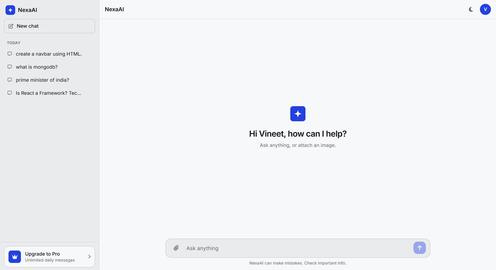
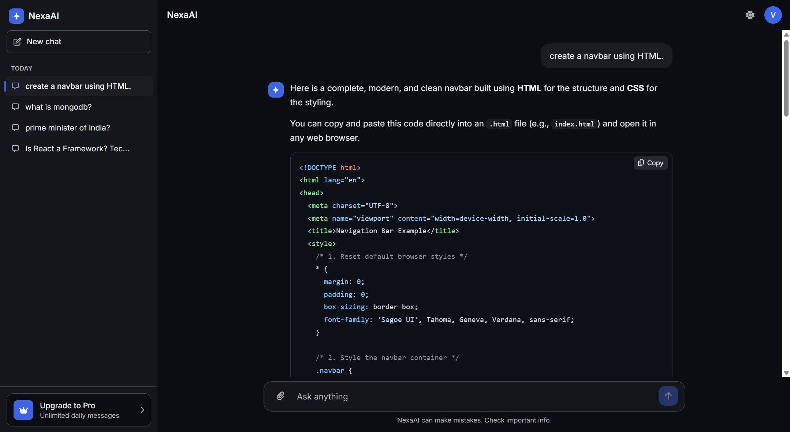
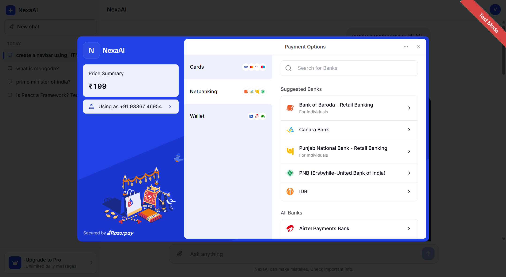
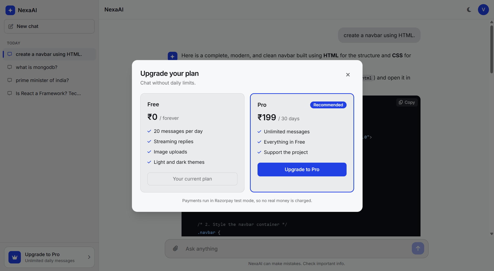
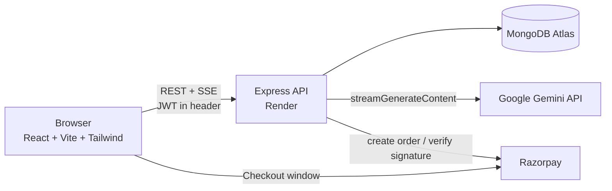

<div align="center">

# NexaAI

### A ChatGPT-style AI chat platform built from scratch with the MERN stack and Google Gemini

Real-time streaming replies, image understanding, secure authentication, Razorpay payments and a clean light/dark UI.

[**Live Demo**](https://nexa-ai-sandy-chi.vercel.app) · [**Report a bug**](https://github.com/vineet6389kg/NexaAI---AI-Powered-Chat-Platform/issues)


</div>

> **Try it in 10 seconds:** open the live demo and click **"Try the demo (no signup)"**. A private guest account is created for you and deleted automatically after 24 hours.
>
> The backend runs on a free Render instance, so the very first request after a quiet period can take up to a minute while the server wakes up.

---

## Screenshots

| Light theme (default) | Dark theme |
| :---: | :---: |
|  |  |

| Payment Gateway | Upgrade to Pro |
| :---: | :---: |
|  |  |

---

## Features

**Chat experience**
- **Real-time streaming:** answers appear word by word using Server-Sent Events, with a **Stop** button that cancels the request to Gemini.
- **Conversation memory:** the last 10 messages are sent with every request, so follow-up questions work.
- **Image understanding:** attach, paste or drag and drop an image and ask about it. Images are shrunk in the browser before upload to keep requests fast.
- **Regenerate** the last answer, and **copy** buttons on every answer and every code block.
- **Markdown rendering** with syntax-highlighted code blocks.
- **Chat history** grouped by Today, Yesterday and Previous 7 days. Chats are saved even if you refresh mid-answer, and the open chat is restored after a reload.

**Accounts and payments**
- **Signup and login** with validated forms, bcrypt password hashing and JWT sessions.
- **One-click guest demo accounts** that delete themselves after 24 hours (MongoDB TTL indexes).
- **Free and Pro plans:** free users get 20 messages per day, and Pro is unlocked through a **Razorpay** checkout (test mode, no real money is charged).

**Design and quality**
- Simple, ChatGPT-like interface with a consistent design-token colour system (OKLCH palette).
- **Light theme by default** with a dark-mode toggle that is remembered between visits.
- Fully responsive, with a slide-in sidebar on mobile.
- Accessible details: labelled inputs, keyboard support, visible focus states, `aria` attributes and reduced-motion support.

---

## Architecture



**How a streamed reply works**
1. The browser sends the question to `POST /api/chat/stream`.
2. The server loads the chat, builds the last-10-message history, and opens a streaming request to Gemini.
3. Every piece of text from Gemini is forwarded to the browser as an SSE event and appended to the answer.
4. When the stream ends, or the user presses Stop or refreshes, the server saves the text received so far to MongoDB.

---

## Tech stack

| Layer | Technologies |
| --- | --- |
| **Frontend** | React 19, Vite, Tailwind CSS v4, React Router, react-markdown, highlight.js |
| **Backend** | Node.js, Express 5, Mongoose |
| **Database** | MongoDB Atlas |
| **AI** | Google Gemini API (streaming) |
| **Auth** | JWT, bcryptjs |
| **Payments** | Razorpay (test mode) |
| **Security** | express-rate-limit, CORS allow-list, input validation |
| **Hosting** | Vercel (frontend), Render (backend), MongoDB Atlas (database) |

---

## Engineering highlights

- **Streaming over `fetch`, not `EventSource`:** the request needs a POST body and an `Authorization` header, so the SSE stream is read manually with `ReadableStream`.
- **Cancelling work properly:** pressing Stop aborts the browser request, and the server then aborts the upstream Gemini call with an `AbortController`, so no tokens are wasted. The partial answer is still saved.
- **Resilience:** Gemini errors `503` and `429` are retried with backoff, and users see a friendly message instead of a stack trace.
- **Secure payments:** the server decides the price and creates the Razorpay order. After payment, the server recomputes the HMAC-SHA256 signature and compares it with `timingSafeEqual`. A payment is marked as claimed with an atomic update, so one payment can never grant Pro twice.
- **Per-user data isolation:** every chat query is scoped to the logged-in user.
- **Abuse protection:** per-user message rate limit, login and signup limits per IP, a daily cap for free users, and request-size and image-type validation.
- **Performance choices:** the sidebar list loads only titles (not full conversations), only the most recent image is sent back to Gemini, and uploaded images are resized and compressed on the client.
- **Self-cleaning demo data:** guest users and their chats expire through MongoDB TTL indexes, with no cron job.

---

## Run it locally

**Requirements:** Node.js 20 or newer, a MongoDB connection string (Atlas free tier works), a [Gemini API key](https://aistudio.google.com/) and, optionally, Razorpay test keys.

```bash
# 1. clone
git clone https://github.com/vineet6389kg/NexaAI---AI-Powered-Chat-Platform.git
cd NexaAI---AI-Powered-Chat-Platform

# 2. backend
cd Backend
npm install
cp .env.example .env        # then fill in the values below
npm start                   # http://localhost:8080

# 3. frontend (new terminal)
cd Frontend
npm install
cp .env.example .env        # VITE_API_URL=http://localhost:8080/api
npm run dev                 # http://localhost:5173
```


> To test payments, use UPI ID `success@razorpay` in Razorpay's test checkout.


---


## Deployment

| Part | Platform | Notes |
| --- | --- | --- |
| Frontend | **Vercel** | Root directory `Frontend`. `vercel.json` rewrites all routes to `index.html` for React Router. |
| Backend | **Render** | Root directory `Backend`, build `npm install`, start `npm start`. |
| Database | **MongoDB Atlas** | Network access allows Render's servers. |

---

## Roadmap

- [ ] Razorpay webhooks, so upgrades work even if the user closes the tab after paying
- [ ] Automated tests (Vitest and Supertest)
- [ ] Chat with PDFs and documents
- [ ] Export a conversation as Markdown or PDF
- [ ] Refresh tokens and HTTP-only cookies for authentication

---

## About me

I'm **Vineet Kumar**, a third-year Computer Science student passionate about full-stack development, backend engineering, and building impactful software. I enjoy creating production-ready applications that combine clean user experiences with robust backend systems. **NexaAI** is a project that helped me learn the core technologies behind modern AI platforms, including streaming, authentication, payments, and abuse protection.


- GitHub: [@vineet6389kg](https://github.com/vineet6389kg)
- LinkedIn: [Vineet Kumar](https://www.linkedin.com/in/vineet-kumar-046373329)

---

<div align="center">

If you like this project, a ⭐ on the repo is much appreciated.

</div>